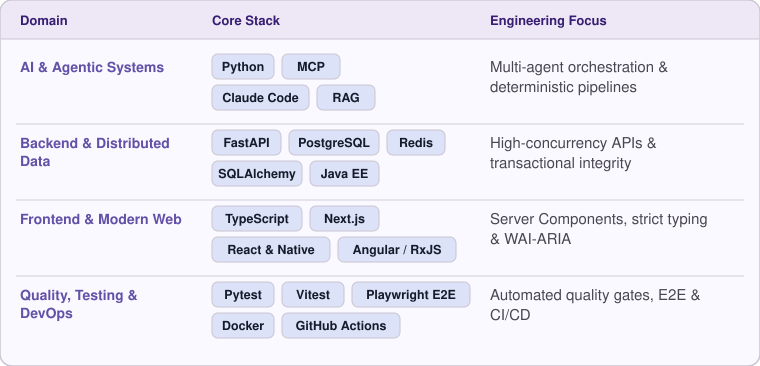

# Hi 👋, I am Yeferson (`yefcode`)

### Software & AI Systems Engineer

*13+ years engineering scalable, high-impact software systems, today amplified by autonomous AI workflows and deterministic agentic tooling. Specialized in distributed architectures, event-driven pipelines, and verifiable software craft across enterprise domains.*

   <a href="https://yefcode.com">yefcode.com</a>
  &nbsp;·&nbsp;
   <a href="mailto:yefcode@gmail.com">yefcode@gmail.com</a>
  &nbsp;·&nbsp;
  📍 Medellín, Colombia
  &nbsp;·&nbsp;
  🌍 Remote

---

## ⚡ Things I Love Engineering

<table>
  <tr>
    <td width="50%" valign="top">
      <h3>🤖 Autonomous AI Agents, Swarms &amp; Workers</h3>
      
<em>Advanced agentic orchestration, multi-agent swarms with workers &amp; deterministic MCP pipelines.</em>

      
Governance and deployment of software agents using Google Antigravity, Claude Code, and Codex, with isolated context tooling, Model Context Protocol (MCP), and deterministic workflow automations.

      <code>Google Antigravity</code> · <code>Claude Code</code> · <code>Codex</code> · <code>MCP</code> · <code>Agent Skills</code>
    </td>
    <td width="50%" valign="top">
      <h3>🧩 Distributed Systems &amp; Resilient Infrastructure</h3>
      
<em>High concurrency, event-driven pipelines &amp; robust data integrity.</em>

      
Designing resilient microservices, high-performance async APIs, and transactional backends with Python (FastAPI), SQLAlchemy Async, PostgreSQL, and Redis queues to power mission-critical workloads.

      <code>FastAPI</code> · <code>PostgreSQL</code> · <code>Redis</code> · <code>Event-Driven</code> · <code>Docker</code>
    </td>
  </tr>
  <tr>
    <td width="50%" valign="top">
      <h3>🛡️ Software Craftsmanship &amp; Rigor</h3>
      
<em>Zero tech debt tolerance, extensive quality gates &amp; production Core Features.</em>

      
Strict business domain isolation (DDD), thorough automated test coverage (Pytest, Vitest, Playwright E2E), surgical refactors, and audit-ready technical documentation.

      <code>Domain-Driven Design</code> · <code>Pytest / Vitest</code> · <code>Playwright E2E</code> · <code>Quality Gates</code>
    </td>
    <td width="50%" valign="top">
      <h3>🖥️ Modern Web Platforms &amp; Fullstack Delivery</h3>
      
<em>Strict TypeScript, server-driven architectures &amp; accessible design systems.</em>

      
Crafting responsive, server-driven web applications with Next.js App Router, React Server Components (RSC), and clean modular CSS without framework bloat or unnecessary dependencies.

      <code>Next.js</code> · <code>TypeScript</code> · <code>CSS Modules</code> · <code>RSC</code> · <code>WAI-ARIA</code>
    </td>
  </tr>
</table>

---

## 🛠️ Tech Stack & Capabilities

  

 

#### 🔹 Variante 1: Píldoras Nativa `<code>` (Monocromática)

<table>
  <thead>
    <tr>
      <th align="left" width="24%">Domain</th>
      <th align="left" width="46%">Core Stack</th>
      <th align="left" width="30%">Engineering Focus</th>
    </tr>
  </thead>
  <tbody>
    <tr>
      <td><strong>AI &amp; Agentic Systems</strong></td>
      <td>
        <code>Python</code> · <code>MCP</code> · <code>Claude Code</code> · <code>RAG</code>
      </td>
      <td>Multi-agent orchestration &amp; deterministic pipelines</td>
    </tr>
    <tr>
      <td><strong>Backend &amp; Distributed Data</strong></td>
      <td>
        <code>FastAPI</code> · <code>PostgreSQL</code> · <code>Redis</code> · <code>SQLAlchemy</code> · <code>Java EE</code>
      </td>
      <td>High-concurrency APIs &amp; transactional integrity</td>
    </tr>
    <tr>
      <td><strong>Frontend &amp; Modern Web</strong></td>
      <td>
        <code>TypeScript</code> · <code>Next.js</code> · <code>React &amp; Native</code> · <code>Angular / RxJS</code>
      </td>
      <td>Server Components, strict typing &amp; WAI-ARIA</td>
    </tr>
    <tr>
      <td><strong>Quality, Testing &amp; DevOps</strong></td>
      <td>
        <code>Pytest</code> · <code>Vitest</code> · <code>Playwright E2E</code> · <code>Docker</code> · <code>GitHub Actions</code>
      </td>
      <td>Automated quality gates, E2E &amp; CI/CD</td>
    </tr>
  </tbody>
</table>

 

#### 🔹 Variante 2: Píldoras Nativa `<kbd>` (Efecto Botón 3D + 100% Ctrl+F)

<table>
  <thead>
    <tr>
      <th align="left" width="26%">Domain</th>
      <th align="left" width="44%">Core Stack</th>
      <th align="left" width="30%">Engineering Focus</th>
    </tr>
  </thead>
  <tbody>
    <tr>
      <td><strong>🤖 AI &amp; Agentic Systems</strong></td>
      <td>
        <kbd>Python</kbd> <kbd>MCP</kbd> <kbd>Claude Code</kbd> <kbd>RAG</kbd>
      </td>
      <td>Multi-agent orchestration &amp; deterministic pipelines</td>
    </tr>
    <tr>
      <td><strong>🧩 Backend &amp; Distributed Data</strong></td>
      <td>
        <kbd>FastAPI</kbd> <kbd>PostgreSQL</kbd> <kbd>Redis</kbd> <kbd>SQLAlchemy</kbd> <kbd>Java EE</kbd>
      </td>
      <td>High-concurrency APIs &amp; transactional integrity</td>
    </tr>
    <tr>
      <td><strong>🖥️ Frontend &amp; Modern Web</strong></td>
      <td>
        <kbd>TypeScript</kbd> <kbd>Next.js</kbd> <kbd>React &amp; Native</kbd> <kbd>Angular / RxJS</kbd>
      </td>
      <td>Server Components, strict typing &amp; WAI-ARIA</td>
    </tr>
    <tr>
      <td><strong>🛡️ Quality, Testing &amp; DevOps</strong></td>
      <td>
        <kbd>Pytest</kbd> <kbd>Vitest</kbd> <kbd>Playwright E2E</kbd> <kbd>Docker</kbd> <kbd>GitHub Actions</kbd>
      </td>
      <td>Automated quality gates, E2E &amp; CI/CD</td>
    </tr>
  </tbody>
</table>

 

#### 🔹 Variante 3: Badges con Paleta Exacta (`#dce2f7` + Logos de Marca)

<table>
  <thead>
    <tr>
      <th align="left" width="24%">Domain</th>
      <th align="left" width="46%">Core Stack</th>
      <th align="left" width="30%">Engineering Focus</th>
    </tr>
  </thead>
  <tbody>
    <tr>
      <td><strong>AI &amp; Agentic Systems</strong></td>
      <td>
        
        
        
        
      </td>
      <td>Multi-agent orchestration &amp; deterministic pipelines</td>
    </tr>
    <tr>
      <td><strong>Backend &amp; Distributed Data</strong></td>
      <td>
        
        
        
        
        
      </td>
      <td>High-concurrency APIs &amp; transactional integrity</td>
    </tr>
    <tr>
      <td><strong>Frontend &amp; Modern Web</strong></td>
      <td>
        
        
        
        
      </td>
      <td>Server Components, strict typing &amp; WAI-ARIA</td>
    </tr>
    <tr>
      <td><strong>Quality, Testing &amp; DevOps</strong></td>
      <td>
        
        
        
        
        
      </td>
      <td>Automated quality gates, E2E &amp; CI/CD</td>
    </tr>
  </tbody>
</table>

